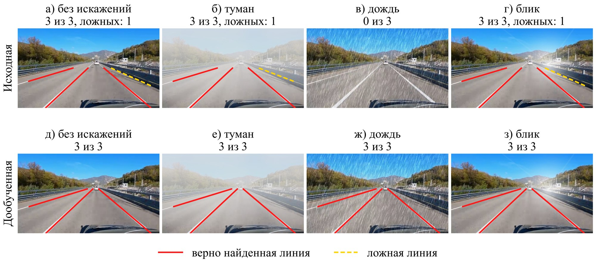
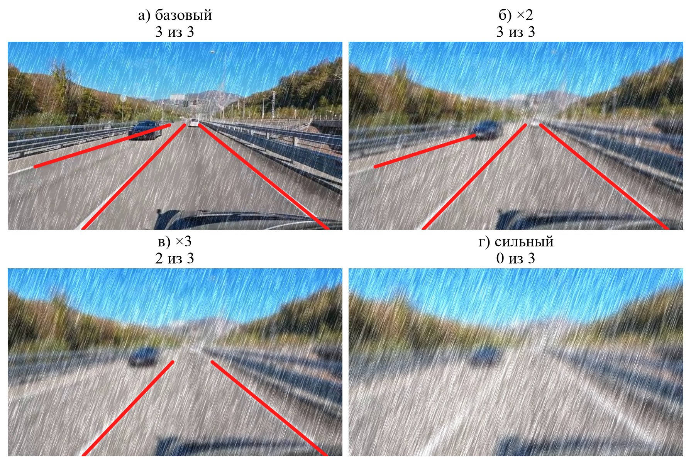
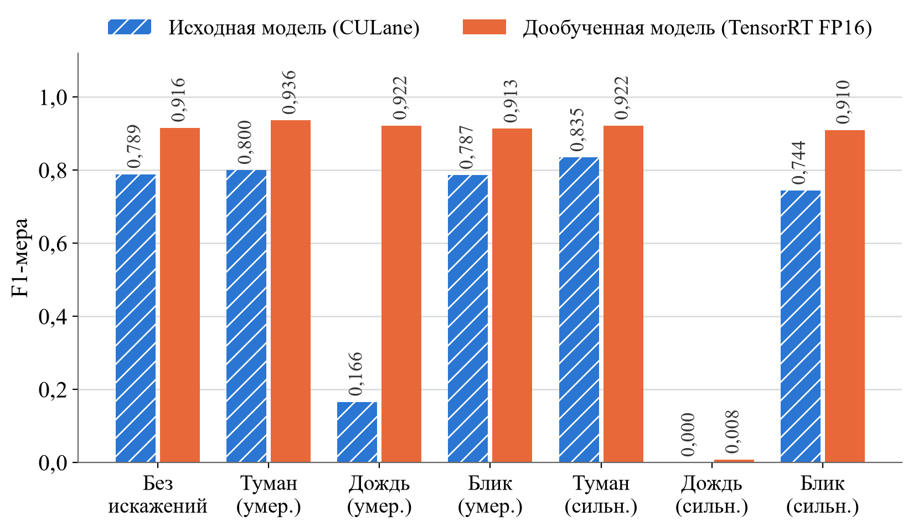

# clrnet-ru-roads

Детекция дорожной разметки моделью CLRNet (ResNet-34), дообученной на российских дорогах с синтетической
аугментацией погоды (туман, дождь, блик). Модель работает в реальном времени через TensorRT FP16, сглаживает
линии на видео фильтром Калмана и запускается в веб-интерфейсе на Linux и Windows.

*Lane detection with CLRNet (ResNet-34) fine-tuned on Russian roads with synthetic weather augmentation
(fog, rain, glare); TensorRT FP16, Kalman tracking on video, web UI; Linux and Windows.*

## Возможности

- Детекция разметки на изображениях и на видео с временным сглаживанием фильтром Калмана.
- Веб-интерфейс Gradio: фото и видео, выбор модели (PyTorch или TensorRT).
- Синтетические погодные искажения для обучения и проверки устойчивости: туман (закон Кошмидера), дождь, блик.
- Экспорт в ONNX и TensorRT FP16/FP32.
- Подготовка собственного набора данных в формате CULane: нарезка видео, предразметка моделью, разметка в CVAT.
- Установка на Linux и на Windows без WSL с самопроверкой.

## Пример работы

Детекция разметки исходной моделью (верхний ряд) и дообученной (нижний ряд) на одном кадре без искажений
и с синтетическими туманом, дождем и бликом. Красным показаны верно найденные линии, желтым пунктиром — ложные.

<div align="center">
  
</div>

Дообученная модель при нарастании интенсивности дождя: качество падает резко, после порога.
Модель не находит линии, но и ложных не выдает.

<div align="center">
  
</div>

## Результаты

Валидационная выборка: 108 кадров, 3 сцены, протокол оценки CULane.

| Условие | F1, исходная модель (CULane) | F1, дообученная (TensorRT FP16) |
|---|---|---|
| Без искажений | 0,789 | 0,916 |
| Туман (умеренный) | 0,800 | 0,936 |
| Дождь (умеренный) | 0,166 | 0,922 |
| Блик (умеренный) | 0,787 | 0,913 |

<div align="center">
  
</div>

Время обработки кадра (RTX 3080, batch 1): 15,7 мс у исходной модели (PyTorch FP32) и 6,0 мс у дообученной (TensorRT FP16).
Искажения синтетические, поэтому результаты не гарантируют такого же качества в реальную непогоду.

## Установка

**Требования.** Видеокарта NVIDIA с драйвером, поддерживающим CUDA 12, и Python 3.9 (более новые версии не подходят:
нужны PyTorch 2.3.1 и numpy 1.23.1). Проверено на RTX 3080 в Linux (WSL2) и в Windows 11 без WSL.

**Версии.** PyTorch 2.3.1 + CUDA 12.1, numpy 1.23.1 (ставится последним шагом), по желанию TensorRT 11.3.
Точные версии всех пакетов — в `requirements-lock.txt`. Собирать CUDA-расширения (NMS, DCN) для CLRNet не нужно.

**Веса.** В git не хранятся, опубликованы в [Releases](https://github.com/Tatemia/clrnet-ru-roads/releases/tag/v1.0);
положите их в папку `checkpoints/`:

| Файл | Формат |
|---|---|
| `clrnet_r34_ru_roads.pth` | PyTorch, веса дообученной модели |
| `clrnet_r34_ru_roads_fp16.onnx` | ONNX: backbone и FPN в FP16, голова в FP32 (для сборки движка TensorRT) |

**Проверка.** После установки `tools/check_install.py` проверяет версии, видеокарту, загрузку модели
и распознавание на кадре, TensorRT, Gradio и ffmpeg.

### Linux

Для сборки CUDA-расширений `nvcc` из CUDA 12.1 требует gcc не новее 12, поэтому компилятор C++ ставится
в окружение отдельно.

```bash
conda create -n unlanedet python=3.9 -y
conda activate unlanedet
conda install -c nvidia/label/cuda-12.1.0 cuda-toolkit -y
conda install -c conda-forge gcc_linux-64=11.4 gxx_linux-64=11.4 -y
export PIP_CONSTRAINT=$PWD/build-constraints.txt   # albumentations 0.4.6 собирается только с setuptools<81
pip install "setuptools<81"
pip install torch==2.3.1 torchvision==0.18.1 --index-url https://download.pytorch.org/whl/cu121
pip install -r requirements.txt -r requirements-app.txt -c requirements-lock.txt
pip install -r requirements-tensorrt.txt -c requirements-lock.txt   # по желанию: экспорт и запуск в TensorRT
pip install numpy==1.23.1 --no-deps        # последним шагом: код и imgaug рассчитаны на эту версию
export CUDA_HOME=$CONDA_PREFIX
pip install -e . --no-build-isolation
python tools/check_install.py
```

### Windows (без WSL)

Нужен Python 3.9 64-bit с `py launcher` ([python.org](https://www.python.org/downloads/release/python-3913/)) —
он ставится рядом с любым другим Python (например, 3.13) и не мешает ему. Папку проекта положите в путь только
из латинских букв, например `C:\clrnet-ru-roads`: OpenCV на Windows не открывает файлы, если в пути есть кириллица.

```bat
windows\setup.bat
```

Скрипт создаёт окружение `.venv` внутри папки проекта, ставит пакеты точных версий и запускает
`tools\check_install.py`. Компилятор не нужен. После установки папку можно перемещать на другой диск;
на другом компьютере `windows\setup.bat` запускается заново.

## Запуск

Что есть:

- детекция разметки на изображениях (`tools/detect.py`) и на видео с временным сглаживанием фильтром Калмана
  (`tools/track_lanes_video.py`);
- веб-интерфейс Gradio (`tools/gradio_app.py`, `http://127.0.0.1:7860`);
- дообучение (`tools/train_net.py` с конфигом `config/clrnet/resnet34_culane_finetune.py`);
- сборка движка TensorRT (`tools/export_tensorrt.py`). Движок привязан к видеокарте и версии TensorRT,
  поэтому собирается на месте; имя берётся из имени чекпоинта (`clrnet_r34_ru_roads_fp16.engine`).

Модели для выбора в веб-интерфейсе перечислены в словаре `CHECKPOINTS` в начале `tools/gradio_app.py`
(пара «путь к весам или движку, конфиг»); для весов из Releases укажите в нём `checkpoints/clrnet_r34_ru_roads.pth`
и `checkpoints/tensorrt/clrnet_r34_ru_roads_fp16.engine` с конфигом `config/clrnet/resnet34_culane_finetune.py`.

Для дообучения от опубликованных весов укажите в `config/clrnet/resnet34_culane_finetune.py`
`init_checkpoint = "checkpoints/clrnet_r34_ru_roads.pth"`, а также `data_root` и `epoch_per_iter` под свой набор
данных. Результаты обучения пишутся в `output/` (`model_best.pth` там перезаписывается).

### Linux

```bash
conda activate unlanedet
python tools/export_tensorrt.py config/clrnet/resnet34_culane_finetune.py checkpoints/clrnet_r34_ru_roads.pth --out-dir checkpoints/tensorrt --precisions fp16
python tools/detect.py config/clrnet/resnet34_culane_finetune.py checkpoints/clrnet_r34_ru_roads.pth --img "images/*.jpg" --savedir vis
python tools/track_lanes_video.py config/clrnet/resnet34_culane_finetune.py checkpoints/clrnet_r34_ru_roads.pth --video input.mp4 --out compare.mp4
python tools/gradio_app.py
python tools/train_net.py --config-file config/clrnet/resnet34_culane_finetune.py --num-gpus 1
```

### Windows

| Скрипт | Что делает |
|---|---|
| `windows\build_tensorrt.bat` | собирает движки TensorRT FP32 и FP16 под эту видеокарту |
| `windows\run_gradio.bat` | веб-интерфейс, `http://127.0.0.1:7860` |
| `windows\train.bat` | дообучение (дополнительные параметры передаются как есть, например `train.max_iter=100`) |
| `windows\console.bat` | консоль с окружением проекта для остальных команд |

Команды детекции в `windows\console.bat` — те же, что для Linux, с путями через `\`:

```bat
python tools\detect.py config\clrnet\resnet34_culane_finetune.py checkpoints\clrnet_r34_ru_roads.pth --img "images\*.jpg" --savedir vis
python tools\track_lanes_video.py config\clrnet\resnet34_culane_finetune.py checkpoints\clrnet_r34_ru_roads.pth --video input.mp4 --out compare.mp4
```

## Состав репозитория

| Путь | Назначение |
|---|---|
| `config/clrnet/resnet34_culane_finetune.py` | конфиг дообучения и инференса (в том числе вероятность погодной аугментации `weather_aug_p`) |
| `unlanedet/data/transform/weather.py`, `weather_imgaug.py` | синтез тумана, дождя и блика; аугментеры imgaug |
| `unlanedet/tracking/lane_tracker.py`, `tools/track_lanes_video.py` | трекинг полос фильтром Калмана |
| `tools/export_tensorrt.py`, `unlanedet/utils/trt_model.py` | экспорт в ONNX/TensorRT и запуск движка |
| `tools/gradio_app.py` | веб-интерфейс |
| `tools/eval_weather_robustness.py`, `tools/compare_models.py`, `tools/benchmark_speed.py` | оценка устойчивости к искажениям и замер скорости |
| `tools/extract_video_frames.py`, `tools/predict_to_cvat.py`, `tools/cvat_*.py`, `tools/gen_culane_*.py` | подготовка и разметка набора данных в формате CULane |
| `windows/`, `tools/check_install.py`, `requirements-lock.txt` | установка и запуск на Windows, самопроверка, точные версии |

Набор данных российских дорог в репозиторий не входит.

## Лицензия

Apache 2.0 (см. `LICENSE`). Проект основан на [UnLanedet](https://github.com/zkyntu/UnLanedet) (Apache 2.0);
из него взяты реализация CLRNet, загрузчики данных и инструменты обучения. Изменены файлы UnLanedet:
`unlanedet/model/CLRNet/clr_head.py` (ускорена постобработка), `unlanedet/data/transform/__init__.py`
(регистрация погодных аугментаций), `unlanedet/data/build.py` (seed аугментаций в процессах загрузки данных),
`unlanedet/utils/env.py`, `config/modelzoo.py`, `tools/detect.py` (подгонка размера кадра под конфиг).
